# NULLSECURE - FROM NULL TO ROOT

**Video Walkthrough:** https://youtu.be/43-K5jXcd1M

**Room:** Anthem
**Platform:** TryHackMe — https://tryhackme.com/room/anthem
**Difficulty:** Easy
**OS:** Windows (standalone, not domain-joined)

---

## Overview

Anthem is an Easy-difficulty, standalone Windows room built around OSINT against a fictional company's website. Reading the site carefully — blog posts, meta tags, page source, and `robots.txt` — leaks the credentials needed for RDP access. From there, a misconfigured NTFS permission on a backup file hands over a second, higher-privileged credential and full Administrator access.

## Recon

```
rustscan -a <target> --ulimit 5000 -- -sC -sV -Pn
```

Two open ports:

- **80/tcp** — HTTP (Microsoft HTTPAPI httpd 2.0 / SSDP-UPnP), hosting *Anthem.com - Welcome to our blog*
  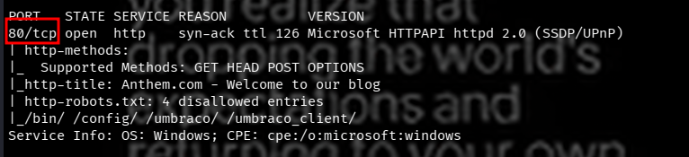
- **3389/tcp** — RDP (Microsoft Terminal Services), `NetBIOS_Computer_Name: WIN-LU09299160F`
  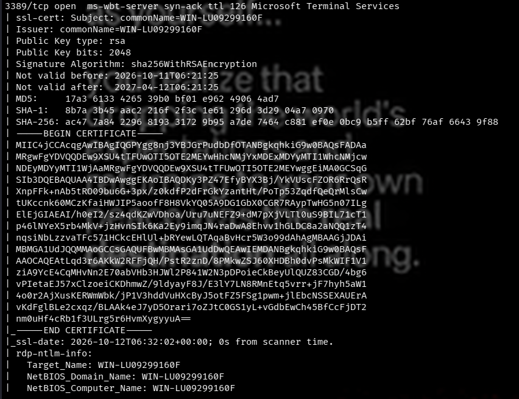

`http-robots.txt` disclosed 4 disallowed entries: `/bin/`, `/config/`, `/umbraco/`, and `/umbraco_client/`. The `/umbraco*` paths identify the site as running the **Umbraco CMS**.

## Vulnerability Identification

- `robots.txt` led to a candidate CMS password: `UmbracoIsTheBest!`
  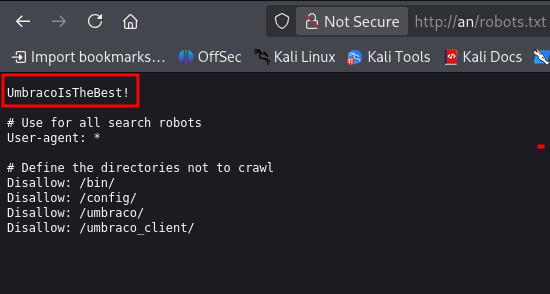
- Confirmed the CMS: **Umbraco**
  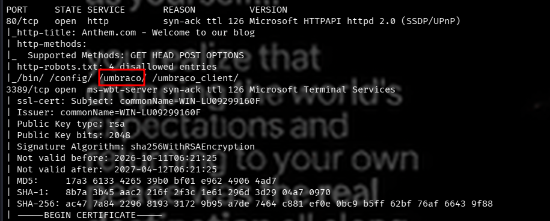
- Confirmed the site's domain: **anthem.com**
  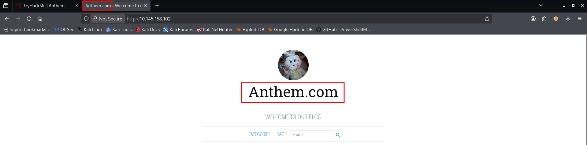
- A blog post riddle, built on the classic nursery rhyme *Solomon Grundy* ("Born on a Monday... Buried on Sunday... That was the end"), identifies the site Administrator's name as **Solomon Grundy**.
  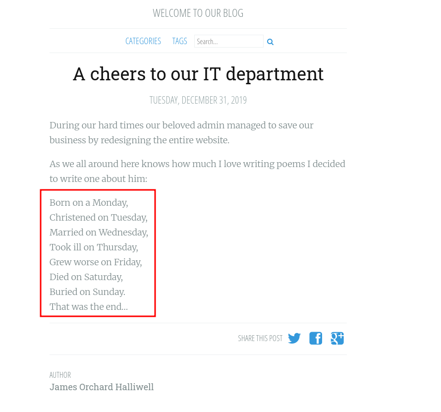
  
- A blog author byline (Jane Doe, `jd@anthem.com`) revealed the company's email naming convention: first-initial + last-initial `@anthem.com`. Applying that pattern to the admin gives **sg@anthem.com** — confirmed working.
  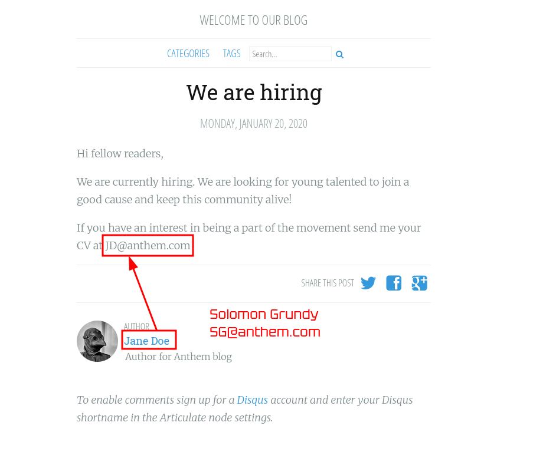
- Browsing to `/umbraco` on the target exposed the Umbraco CMS login page, with two candidate emails and one known password.
  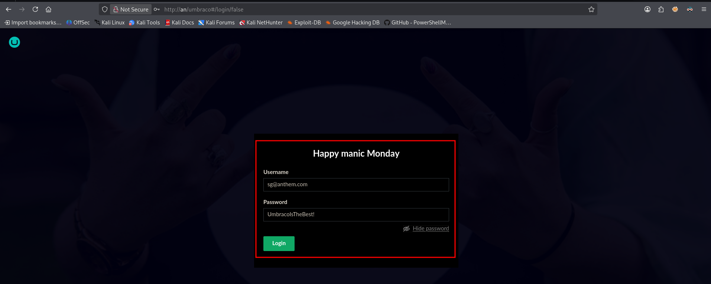

## Exploitation

Authenticated to the Umbraco backend at `/umbraco` with:

```
sg@anthem.com : UmbracoIsTheBest!
```

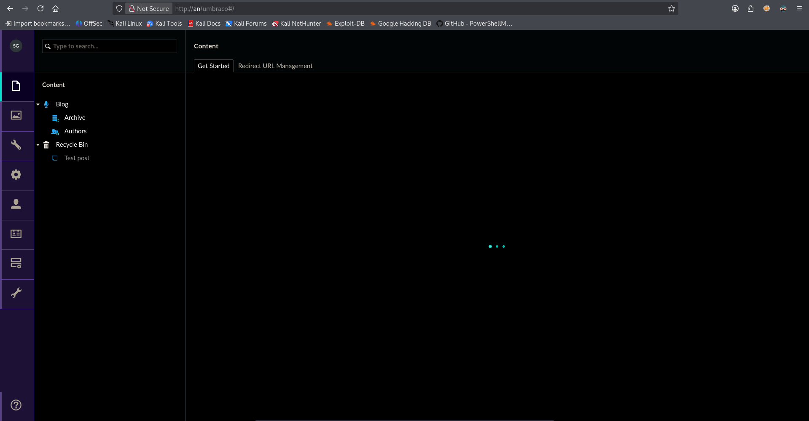

With CMS access, four flags were recovered from the blog content:

| Flag | Location | Value |
|---|---|---|
| Flag 1 | Blog → Archive → *"Anthem are hiring!"* → Meta Tags | `THM{L0L_WH0_US3S_M3T4}` |
| Flag 2 | View Page Source | `THM{G!T_G00D}` |
| Flag 3 | Solomon Grundy riddle post | `THM{L0L_WH0_D15}` |
| Flag 4 | Blog → Archive → *"A cheers to our IT department"* → Meta Tags | `THM{AN0TH3R_M3TA}` |

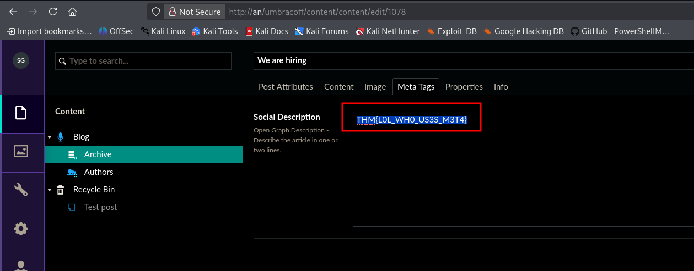
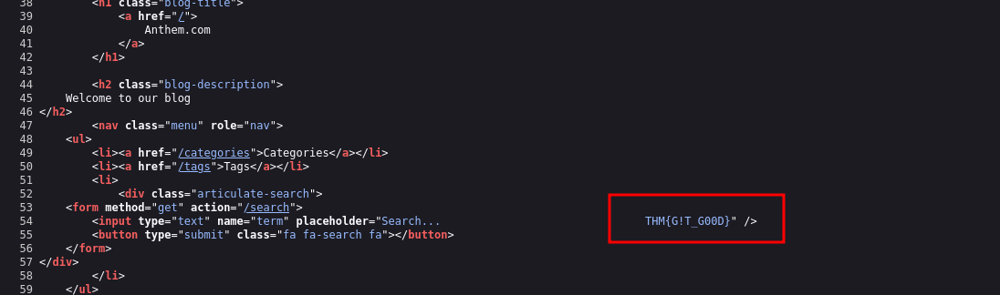
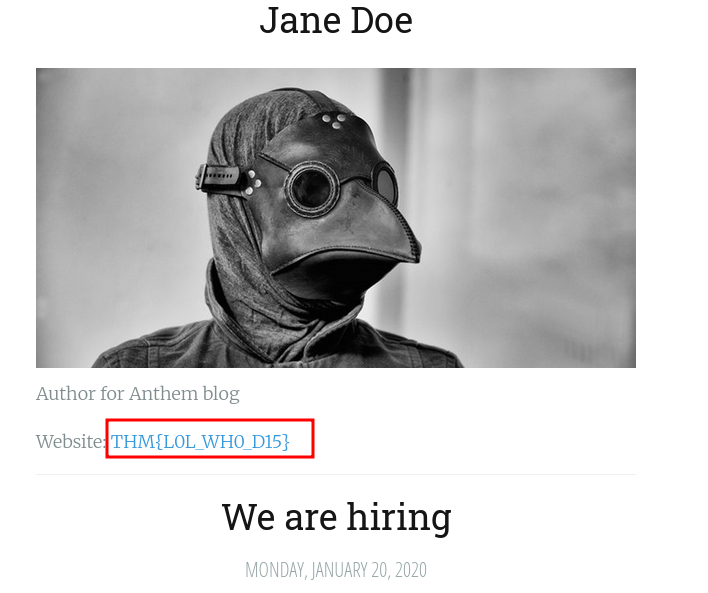
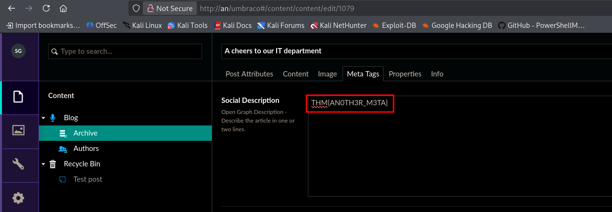

## Post-Exploitation

RDP'd into the host with the recovered `sg` credentials:

```
xfreerdp /compression /cert:ignore +auto-reconnect /v:<target> /u:sg /p:'UmbracoIsTheBest!' +clipboard
```

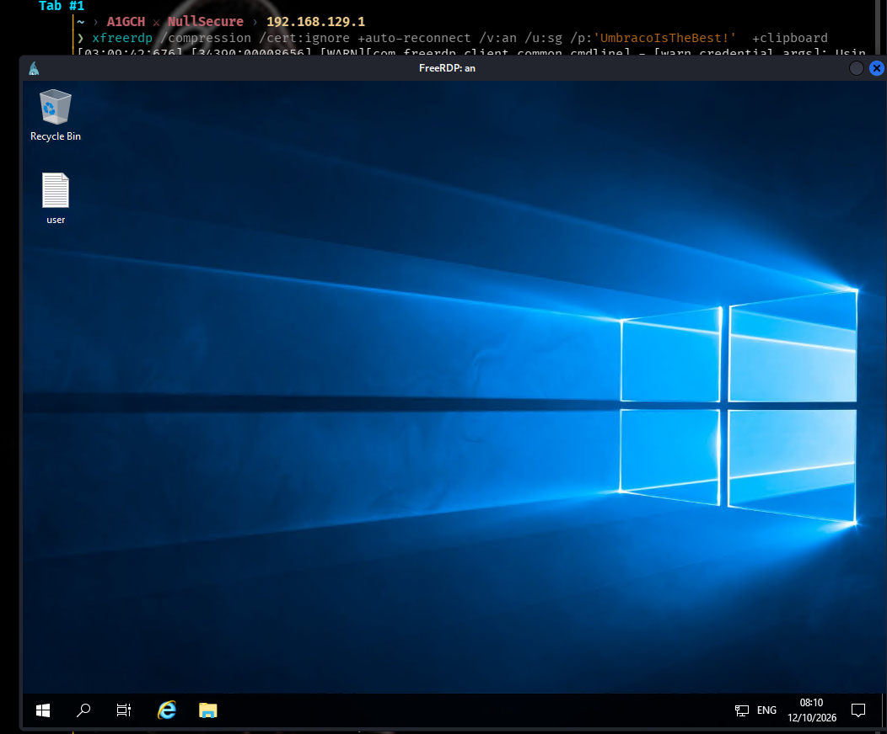

**User flag:** `THM{N00T_NO0T}`

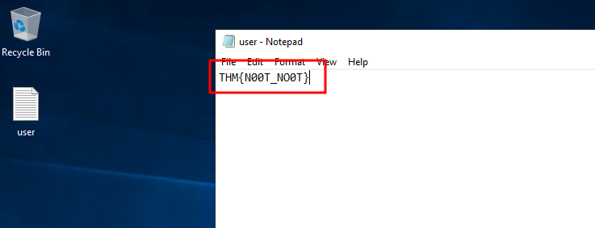

## Privilege Escalation

- Browsed the `C:` drive and enabled **Show hidden items**, revealing a `backup` folder.
  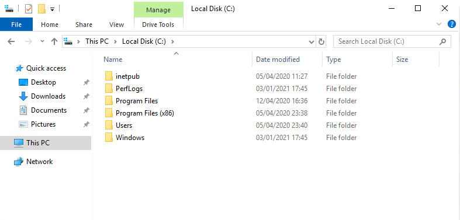
  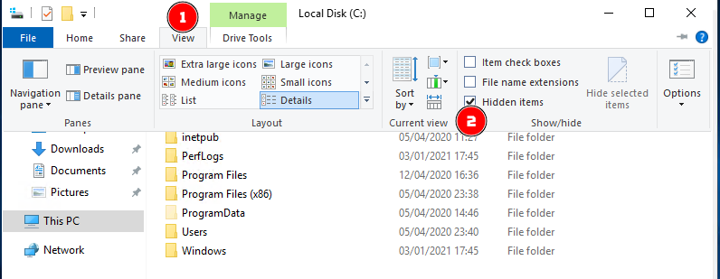
- Inside `backup` was a file named `restore` — unreadable, since `sg` had no NTFS permissions on it.
  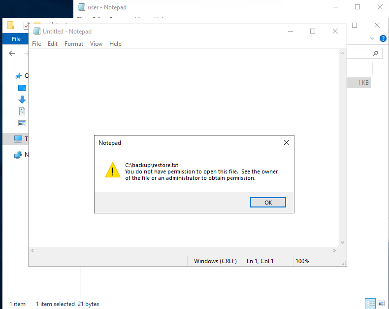
- Opened **Properties → Security → Edit → Add**, granted `WIN-LU09299160F\sg` access to the file, and applied the change.
  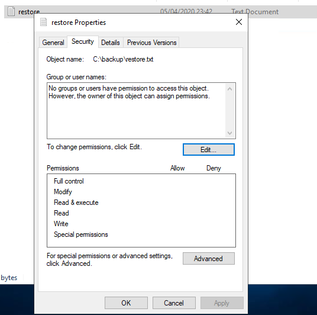
  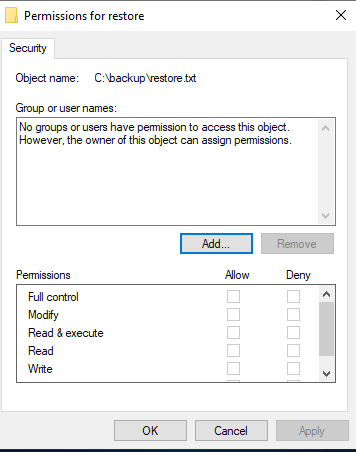
  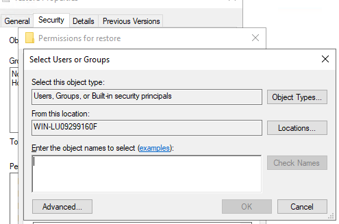
  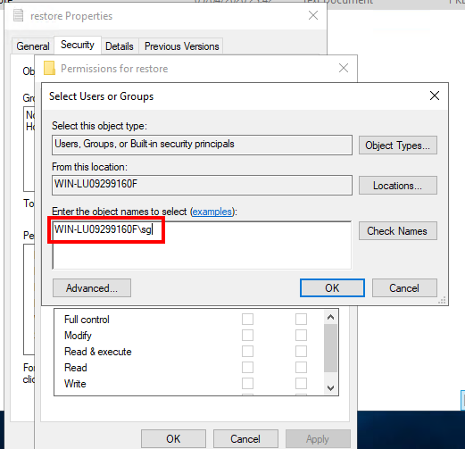
- Reading `restore` now disclosed a second plaintext credential: **`ChangeMeBaby1MoreTime`**
  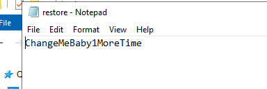
- Switched user to **Administrator** with that password.
  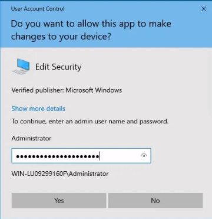

**Root flag:** `THM{Y0U_4R3_1337}`

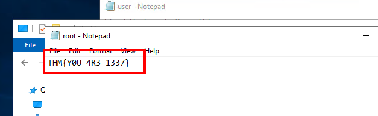

## Conclusion

Anthem is a clean OSINT-driven initial-access exercise — no CVE exploitation required. The entire foothold comes from patiently reading a company blog, its `robots.txt`, and a nursery-rhyme riddle for the admin's identity. The privilege-escalation stage is a good reminder that a single misconfigured ACL on a backup file is enough to fully compromise a host once an attacker holds any valid low-privileged session.

## Attack Chain Summary

`robots.txt` disclosure → `UmbracoIsTheBest!` candidate password → blog OSINT (Solomon Grundy riddle + email-naming convention) → `sg@anthem.com` derived → Umbraco CMS login (`/umbraco`) → 4 flags harvested from blog meta tags / page source → RDP as `sg` → user flag → `backup\restore` ACL misconfiguration exploited (grant `sg` read) → leaked Administrator password (`ChangeMeBaby1MoreTime`) → Administrator access → root flag

---

*This writeup documents a walkthrough solved in an authorized lab environment (TryHackMe) and is intended for educational purposes only.*

**A1GCH ⚔ NullSecure**
